# DRAFT — DA2026_Laporan_NamaTim_NamaKetua

> **Catatan penyusunan (hapus sebelum dikumpulkan).**
> - **Wadah dan format:** salin isi draf ini ke salinan template resmi panitia (Google Docs). Formatnya Times New Roman 12 pt, spasi 1,15, rata kanan-kiri, kertas A4.
> - **Batas halaman:** isi Bab I–IV paling banyak 20 halaman. Sampul, daftar isi, daftar pustaka, dan lampiran tidak dihitung, sehingga grafik yang tidak muat dapat dipindah ke Lampiran.
> - **Bagian yang masih kosong:** sampul, daftar isi, subbab 2.4 (desain visualisasi), subbab 3.2–3.3 (tangkapan layar dan pembahasan dashboard), serta link dashboard di Lampiran A.
> - **Sumber data:** seluruh angka berasal dari 33 file dataset panitia. Tidak ada dataset eksternal yang dipakai, dan file asli tidak diubah (checksum identik dengan unduhan asli).

---

## [HALAMAN SAMPUL — diisi]
Judul proyek · Logo institusi · Nama tim · Nama ketua & anggota · Institusi

## [DAFTAR ISI · DAFTAR TABEL · DAFTAR GAMBAR — dibuat otomatis di Google Docs]

---

## BAB I PENDAHULUAN

### 1.1 Latar Belakang
Studi ini menganalisis data sintetis kualitas udara dan kesehatan masyarakat di berbagai wilayah Indonesia yang disediakan panitia. Data tersebut terdiri atas tiga kelompok:
- rekaman polutan dan cuaca per jam dari 27 stasiun pemantau (AQMS) di lima pulau besar;
- data harian kasus kesehatan dari 27 rumah sakit rujukan;
- tabel master dan metadata.

Periode pengamatan adalah 1 Januari 2024 – 14 Oktober 2026. Dataset ini menggambarkan hubungan antara konsentrasi polutan, karakteristik wilayah, dan dampaknya pada kelompok rentan seperti balita dan lansia. Sebagai acuan evaluasi, studi ini memakai baku mutu udara ambien PP 22/2021, kategori ISPU (Permen LHK 14/2020), dan pedoman kesehatan WHO 2021.

### 1.2 Rumusan Masalah
1. Bagaimana kondisi kualitas udara antarstasiun dan antarpulau dibandingkan dengan baku mutu nasional dan pedoman kesehatan, dan bagaimana kecenderungannya dari waktu ke waktu?
2. Kapan dan di mana pencemaran paling kritis, ditinjau dari jam, hari kerja vs akhir pekan, musim, dan episode kabut asap? Bagaimana perbedaannya antara kawasan perkotaan, industri, dan latar bersih?
3. Faktor apa yang paling memengaruhi variasi polutan: suhu, kelembapan, angin, intensitas lalu lintas, jarak ke jalan raya, atau tipe lokasi?
4. Seberapa besar peningkatan PM2.5 berhubungan dengan kasus ISPA, asma, PPOK, kardiovaskular, dan kematian? Berapa lama efek jedanya, dan kelompok mana yang lebih rentan, balita atau lansia?
5. Apakah jaringan pemantauan saat ini memadai, dan wilayah mana yang perlu diprioritaskan untuk penambahan titik pantau?

### 1.3 Tujuan Proyek
Proyek ini menjawab kelima rumusan masalah tersebut dengan analisis data yang terukur, lalu menyajikannya dalam dashboard interaktif. Dashboard itu harus menunjukkan waktu rawan, sebaran wilayah tercemar, dan kaitannya dengan kasus kesehatan sebagai dasar pengambilan keputusan yang tepat sasaran.

---

## BAB II DESAIN IMPLEMENTASI

### 2.1 Karakteristik Dataset

| Kelompok | File | Isi | Ukuran |
|---|---|---|---|
| Data udara | 27 × `[KODE]_[Lokasi]_AQMS.csv` | PM2.5, PM10, SO₂, CO, O₃, NO₂, suhu, kelembapan, kecepatan & arah angin, `qc_flag` | 24.432 jam per stasiun (PLB-01: 36.381 baris; MDN-01: 20.800 baris) |
| Data kesehatan | `HLT-01_health_outcomes_daily.csv` | Kasus harian per RS: ISPA balita, ISPA lansia, darurat asma, PPOK, pernapasan umum, kardiovaskular, kematian; suhu, titik embun, kelembapan | 27.491 baris (27 RS × ±1.018 hari) |
| Tabel master | `sites.csv`, `sensors.csv`, `hospitals.csv` | Lokasi & karakteristik stasiun (tipe lokasi, lalu lintas, jarak ke jalan), sensor, rumah sakit | 27 baris masing-masing |
| Metadata | `metadata_sensors.csv`, `metadata_dates.csv` | Spesifikasi instrumen; periode & resolusi rekaman | 16 & 27 baris |

**Kunci relasi antartabel** (sesuai booklet): `station` ↔ `location_id` ↔ `sensor_id` (SENS-0NN) ↔ `hospital_id` (RS-XXX-NN).

**Definisi variabel kesehatan** mengikuti klarifikasi QnA panitia:
- `resp_admissions_under5` = rawat inap ISPA pada balita;
- `resp_admissions_over60` = rawat inap ISPA pada lansia >60 tahun;
- `resp` = rawat inap gangguan pernapasan secara umum, mencakup **seluruh kelompok umur dan semua jenis** gangguan pernapasan.

### 2.2 Tools yang Digunakan
- **Bahasa dan pustaka:** Python 3.13 dengan pandas & NumPy (pengolahan data), SciPy (uji statistik), statsmodels (regresi GLM quasi-Poisson & OLS), scikit-learn (Random Forest & *permutation importance*), dan matplotlib (grafik).
- **Alasan:**
  - Seluruh proses dapat direproduksi dari data mentah dengan satu perintah.
  - Setiap langkah pembersihan tercatat otomatis di `cleaning_log`.
  - Pustaka statistiknya mendukung model deret waktu kesehatan-lingkungan, yang tidak tersedia di alat spreadsheet.
- **Dashboard:** *web app* statis yang dibangun dengan Node.js:

  | Bagian | Pustaka |
  |---|---|
  | Antarmuka | React 19 |
  | Build | Vite 8 |
  | Grafik interaktif | ECharts 6 |
  | Peta | Leaflet 1.9 |
  | Animasi & transisi halaman | Framer Motion |

  - **Alasan:**
    - Tidak ada batasan alat menurut handbook, dan kombinasi ini memberi kendali penuh atas interaktivitas, transisi, dan alur cerita, yang sulit dicapai dengan alat BI siap pakai.
    - Hasil build berupa situs statis, sehingga dapat dihosting gratis dan dibuka juri tanpa login.
    - Dashboard membaca data yang sama dengan laporan, sehingga angka di keduanya identik.

### 2.3 Preprocessing Data
Prinsip yang dipegang:
1. File asli **tidak pernah diubah**.
2. **Tidak ada data yang ditambahkan.** Jam yang tidak terekam tidak diisi, tidak diimputasi, dan tidak dipinjam dari stasiun lain.
3. Setiap tindakan dicatat beserta jumlah nilai yang terdampak.

**Tabel 2.1 Masalah kualitas data dan penanganannya**

| No | Masalah | Stasiun | Skala | Penanganan |
|---|---|---|---|---|
| 1 | Satuan **ppm**, bukan µg/m³ | BJB-01, MDN-01, PSW-01 | 3 stasiun × 6 polutan | Dikonversi ke µg/m³ (lihat 2.3.1) |
| 2 | *Clock drift*: timestamp bergeser beberapa menit/detik (mis. 23:48:15, 00:11:22) | 17 stasiun | 423.529 baris | Dibulatkan ke jam terdekat |
| 3 | Resolusi campuran: jendela 15 menit setiap Sep–Okt | PLB-01 | 15.933 baris | Dirata-rata menjadi per jam (min. 3 dari 4 valid); arah angin dirata-rata vektor |
| 4 | Jam tidak terekam | MDN-01 | 3.632 jam | Dibiarkan kosong; tidak diisi/diimputasi |
| 5 | Sensor rusak: kode error (`0xDEADBEEF`, `ERR_COMM_TIMEOUT`, `#VALUE!`, `inf`), timestamp 1970, durasi negatif; hanya 0,5% baris VALID | JMB-02 (status *Defective*) | 24.432 baris | Dikeluarkan dari analisis. RS-XXX-27 (pasangannya) tidak dimodelkan karena tidak punya data paparan; tidak diberi stasiun pengganti |
| 6 | Nilai sentinel (−9999, −999, −99, 999, 999,9, 9999, −273,2, 1450,5) | JMB-02, SM2-01, MER-01 | 80.385 nilai | Dijadikan kosong (NaN). Nilai 999 tidak dianggap sentinel untuk CO karena 999 µg/m³ berada dalam rentang normal CO di data Jakarta |
| 7 | Sensor macet (*flatline*) padahal QC = VALID: PM2.5 tepat 0,3367 ppm selama 4.886 jam dan 0,0035 ppm selama 2.443 jam | BJB-01 | 7.329 jam | Aturan: ≥6 jam berturut-turut bernilai identik → NaN |
| 8 | `qc_flag` selain VALID (SUSPECT, CALIBRATING, MAINTENANCE, WARMUP, MISSING). WARMUP & MAINTENANCE tidak tercantum dalam kategori QC di `metadata_sensors.csv` (VALID, SUSPECT, CALIBRATING, MISSING) | Semua; flag tak terdokumentasi di MDN-01, MER-01, SM2-01, JMB-02 | 171.439 nilai polutan | Polutan: hanya VALID yang dipakai. Meteorologi tetap dipakai saat CALIBRATING/MAINTENANCE/WARMUP karena alat cuaca (Vaisala WXT536) terpisah dari analyzer polutan (`sites.csv`) |
| 9 | Di luar batas fisik (PM negatif, suhu 99 °C, RH >100%) | MER-01, JMB-02 | ±60 ribu nilai | → NaN |
| 10 | *Spike* 1 jam terisolasi | KTG-01/02 (CO) | 10 nilai | → NaN. Aturannya ketat agar awal kabut asap yang nyata tidak terhapus |
| 11 | Data kesehatan bertanggal 2023-12-31 (di luar periode AQMS); kolom `time` dihitung per RS sehingga tidak seragam | HLT-01 | 5 baris; 5.090 baris | Dibuang; diganti `day_index` global |
| 12 | `resp` < ISPA balita + ISPA lansia. Menurut QnA, `resp` mencakup semua umur & jenis, jadi seharusnya ≥ jumlah keduanya | HLT-01 | 92 baris | Ditandai (`flag_resp_lt_u5_o60`), tidak diubah/dibuang |
| 13 | `region_group` tidak konsisten (JMB-02 = "Sumatera", MER-01 = "Papua") | sites/sensors | — | Dipakai kolom `provinsi`, ditambah pengelompokan pulau |

**Hasil preprocessing**
- **Data per jam:** dari 659.664 jam yang semestinya ada (27 × 24.432), terdapat 655.808 jam terekam, dan 88,4% di antaranya memiliki PM2.5 valid (91,7% tanpa JMB-02).
- **Kelengkapan PM2.5 rendah** (kurang dari 75%):

  | Stasiun | Kelengkapan PM2.5 |
  |---|---|
  | MER-01 | 20% |
  | MDN-01 | 68% |
  | BJB-01 | 70% |

  Nilai stasiun-stasiun ini tetap dilaporkan, dengan catatan.
- **Data turunan:**
  - **Rata-rata harian:** dihitung bila ≥18 dari 24 jam valid.
  - **ISPU harian (Permen LHK 14/2020):** dihitung dari PM2.5, PM10 dan SO₂ (rata-rata 24 jam), CO (8 jam maksimum), serta O₃ dan NO₂ (1 jam maksimum).
  - **Penanda baku mutu:** melewati baku mutu 24 jam PP 22/2021 dan pedoman WHO.
  - **Episode kabut asap:** ≥3 hari berturut-turut dengan PM2.5 >55,4 µg/m³ dan >2× median musim hujan stasiun itu.
  - **Jeda paparan:** PM2.5 lag 0–7 hari untuk tiap RS.
- **Evaluasi baku mutu tahunan:** dilakukan per tahun kalender (2024, 2025, dan 2026 parsial), hanya untuk stasiun dengan kelengkapan ≥75% pada tahun tersebut.
- **IKU (Permen LHK 27/2021):** dihitung per stasiun per tahun dari rata-rata tahunan NO₂ dan SO₂.
  - Ieu = ((NO₂/40) + (SO₂/20)) / 2
  - IKU = 100 − (50/0,9) × (Ieu − 0,1)
- **Pengelompokan pulau:** lima pulau sesuai booklet. Kepulauan Riau (BTM-01) dikelompokkan ke Sumatera.

#### 2.3.1 Konversi Satuan ppm → µg/m³
Menurut QnA panitia, metode konversi ditentukan peserta. Asumsinya harus berdasar ilmiah, diterapkan konsisten, dan dijelaskan di laporan. Seluruh nilai ppm dikonversi dengan satu rumus pada kondisi standar 25 °C dan 1 atm, dengan volume molar 24,45 L/mol (Seinfeld & Pandis, 2016):

**µg/m³ = ppm × M × 1000 / 24,45**

| Parameter | Basis ppm | M (g/mol) | Faktor | Dasar |
|---|---|---|---|---|
| SO₂ | ppmv (fraksi volume) | 64,066 | 2.620,3 | Berat molekul gas |
| CO | ppmv | 28,010 | 1.145,6 | Berat molekul gas |
| O₃ | ppmv | 47,998 | 1.963,1 | Berat molekul gas |
| NO₂ | ppmv | 46,006 | 1.881,6 | Berat molekul gas |
| PM2.5, PM10 | **ppmw** (fraksi massa terhadap udara) | 28,97 (udara kering) | 1.184,9 | Setara ppm(massa) × densitas udara 1,185 kg/m³ |

**Alasan basis ppmw untuk PM:** partikulat tidak memiliki berat molekul, sehingga ppm untuk PM hanya bermakna sebagai fraksi massa terhadap udara. Fraksi massa dikali densitas udara sama dengan memakai massa molar udara dalam rumus yang sama, sehingga satu rumus berlaku konsisten untuk semua parameter.

**Pemeriksaan dengan data:**
- Setelah dikonversi, gas di PSW-01 setara dengan rata-rata 11 stasiun berpola serupa di dataset:

  | Gas | PSW-01 (µg/m³) | Rata-rata stasiun serupa (µg/m³) |
  |---|---|---|
  | SO₂ | 7,5 | 7,0 |
  | O₃ | 11,6 | 13,4 |
  | NO₂ | 20,7 | 19,8 |
- Konversi sederhana ×1000 justru menghasilkan nilai 1,8–2,5 kali lebih rendah dari stasiun-stasiun tersebut.

**Sensitivitas:** bila PM dikonversi dengan ×1000 (asumsi mg/m³), nilai PM ketiga stasiun turun 16%. Kesimpulan tidak berubah karena ketiganya tetap di atas baku mutu.

### 2.4 Proses Desain Visualisasi
**Alur cerita.** Dashboard mengikuti tema *From Roots to Clarity*: dari gambaran besar, ke akar masalah, ke dampak, lalu ke solusi. Halamannya:
1. **Ringkasan** — KPI, peta, dan lima temuan utama.
2. **Kondisi Udara** (Tujuan 1).
3. **Waktu & Wilayah Kritis** (Tujuan 2).
4. **Faktor Penyebab** (Tujuan 3).
5. **Dampak Kesehatan** (Tujuan 4).
6. **Jaringan & Rekomendasi** (Tujuan 5).
7. **Data & Metode** — transparansi preprocessing.

Setiap halaman dibuka dengan pertanyaan riset dan "jawaban singkat", baru kemudian bukti visualnya.

**Pemilihan grafik.**

| Kebutuhan | Bentuk grafik |
|---|---|
| Perbandingan antarstasiun | Batang horizontal berurut dengan garis baku mutu/WHO |
| Komposisi kategori ISPU | Batang 100% bertumpuk |
| Tren | Garis bulanan dengan slider zoom |
| Pola bulanan | *Heatmap* stasiun × bulan |
| Episode kabut asap | Linimasa (*Gantt*) |
| Hubungan antarvariabel | *Scatter* |
| Efek jeda | Batang dengan interval kepercayaan 95% |
| Paparan vs kasus harian | Dua panel tersinkron (tanpa sumbu ganda) |
| Sebaran & celah jaringan | Peta |

**Warna.**
- Navy dan kuning dari logo Gelar Rasa untuk elemen antarmuka.
- Palet kategori tetap untuk pulau dan tipe lokasi, sehingga warna yang sama selalu berarti hal yang sama di semua halaman.
- Skala ISPU divergen untuk kategori kualitas udara.

**Interaktivitas.**
- **Filter global:** pulau, tipe lokasi, stasiun (perbandingan 1–6), periode, dan musim. Filter memengaruhi semua halaman.
- **Panel detail stasiun:** terbuka dari peta, grafik, atau tabel.
- **Kontrol per grafik:** tooltip, zoom, tampilan tabel, dan unduhan PNG.
- **Navigasi:** transisi animasi antarhalaman, tombol ← →, geser layar, dan mode cerita otomatis untuk presentasi.
- **Penanda kartu:** setiap kartu diberi label "Ikut filter" atau "Hasil model / Seluruh periode", agar jelas angka mana yang berubah mengikuti filter.

Grafik analisis pada laporan ini memakai prinsip berikut:
- satu sumbu per grafik;
- warna kategori tetap per pulau dan per tipe lokasi;
- skala ISPU divergen: biru = Baik, abu = Sedang, merah bertingkat = Tidak Sehat hingga Berbahaya;
- garis acuan baku mutu dan WHO pada grafik konsentrasi.

---

## BAB III HASIL DAN ANALISIS

### 3.1 Exploratory Data Analysis

#### 3.1.1 Kondisi Kualitas Udara (Ruang & Waktu)

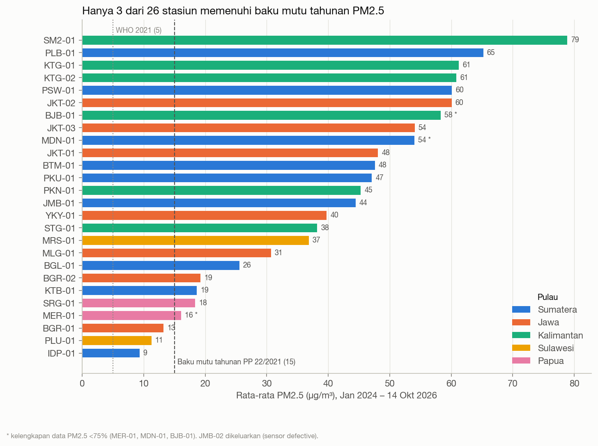

- **Pemenuhan baku mutu tahunan PP 22/2021**, dievaluasi per tahun kalender. Yang dihitung hanya stasiun dengan kelengkapan ≥75%: 23 stasiun pada 2024–2025 dan 24 pada 2026; tahun 2026 hanya mencakup 1 Jan–14 Okt.

  | Polutan | Baku mutu tahunan | Stasiun yang memenuhi (2024 / 2025 / 2026) | Keterangan |
  |---|---|---|---|
  | PM2.5 | 15 µg/m³ | 3 / 3 / 3 | Selalu IDP-01, PLU-01, BGR-01 |
  | PM10 | 40 µg/m³ | 9 / 7 / 7 | — |
  | NO₂ | 50 µg/m³ | 20 / 20 / 21 | JKT-01 (56), JKT-02 (62), JKT-03 (60) melewati setiap tahun |
  | O₃ | 35 µg/m³ | 20 / 20 / 21 | Ketiga stasiun Jakarta (36) sedikit melewati setiap tahun |
  | SO₂ | 45 µg/m³ | semua | — |

  Tidak ada stasiun yang memenuhi pedoman WHO untuk PM2.5 (5 µg/m³).
- **Baku mutu jangka pendek PP 22/2021:**
  - **1 jam:** tidak pernah terlampaui untuk SO₂ (150), NO₂ (200), CO (10.000), maupun O₃ (150 µg/m³).
  - **CO 8 jam:** baku mutu 4.000 µg/m³ terlampaui 28 hari, seluruhnya di KTG-01/02 saat kabut asap (maksimum 7.839 µg/m³).
  - **PM2.5 24 jam:** pelanggaran harian yang paling sering terjadi (lihat ISPU).
- **IKU (Permen LHK 27/2021)**, dihitung dari rata-rata tahunan NO₂ dan SO₂, hasilnya sama pada ketiga tahun:

  | Kategori IKU | Stasiun |
  |---|---|
  | Sangat Baik | IDP-01 |
  | Baik | 21 stasiun |
  | Sedang | MDN-01 |
  | Kurang | JKT-01, JKT-03 |
  | Sangat Kurang | JKT-02 |

  Karena IKU hanya memakai gas, wilayah kabut asap tetap berkategori *Baik* meski PM2.5-nya tinggi. Jadi IKU perlu dibaca bersama ISPU.
- **Antarpulau** (rata-rata PM2.5): **Kalimantan 57,1 > Sumatera 41,3 > Jawa 37,9 > Sulawesi 24,0 > Papua 17,2 µg/m³**. Jawa tertinggi untuk NO₂ (37,9) dan CO (1.028 µg/m³), sedangkan Kalimantan tertinggi untuk PM10 (80,6).
- **ISPU harian:** Baik 17,8%, Sedang 64,6%, Tidak Sehat 16,6%, Sangat Tidak Sehat 0,6%, Berbahaya 0,4% hari. PM2.5 adalah polutan dominan.

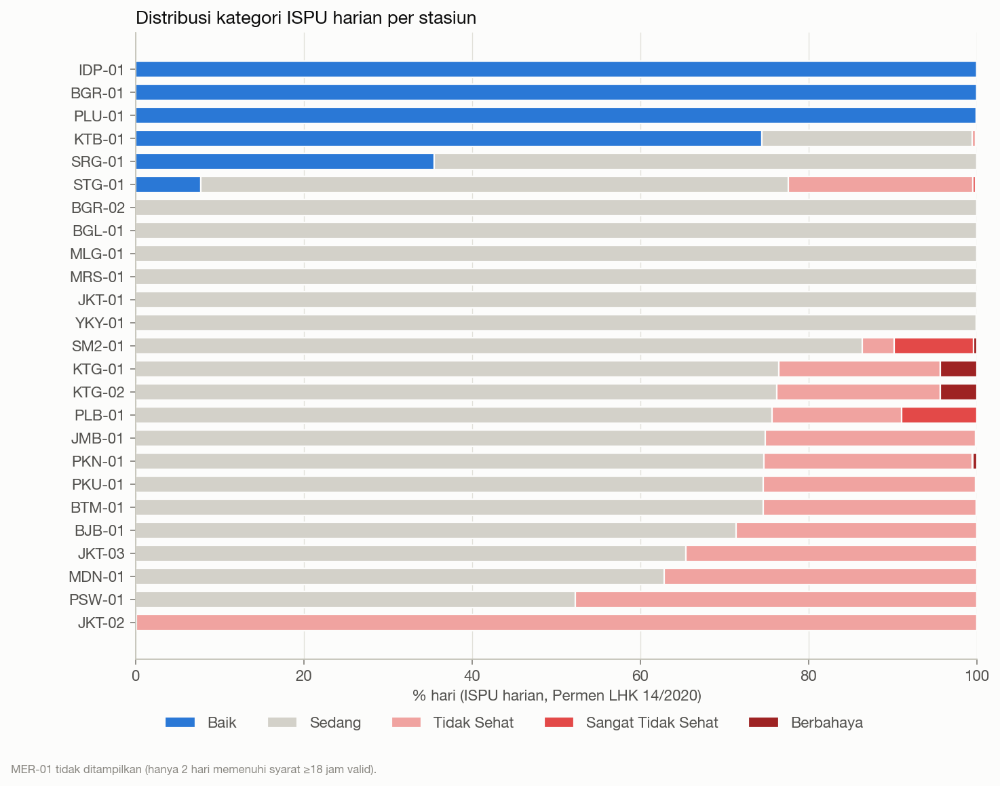

**Kecenderungan 2024–2026** (rata-rata 1 Jan–14 Okt setiap tahun agar 2026 sebanding):
- **Memburuk:** 12 stasiun naik >10%, seluruhnya di Sumatera dan Kalimantan.
  - KTG-01/02 (Kalimantan Tengah) +294–299%. Rata-rata musim kabut naik dari **49 → 96 → 371 µg/m³**.
  - PKN-01 +76%, STG-01 +60%, KTB-01 +51%.
- **Penyebab kenaikan:** hampir seluruhnya dari musim kabut asap. Tingkat dasar musim hujan stabil (uji Mann–Kendall tidak signifikan).
  - Pengecualian: **SM2-01** (tipe "Industrial & Deforestation Buffer"), yang tingkat dasarnya naik +9,5 µg/m³/tahun (+23%/tahun; p < 0,001).
- **Stabil:** seluruh stasiun Jawa, Sulawesi, dan Papua (±1%).
- **KTB-01** (latar bersih) mulai mengalami episode kabut asap pada 2026.
- **Catatan BJB-01:** perbandingan antartahun kurang andal, karena periode sensor macet (Sep 2024–Jul 2025) dibuang sehingga 2025 hanya berkelengkapan 48%.

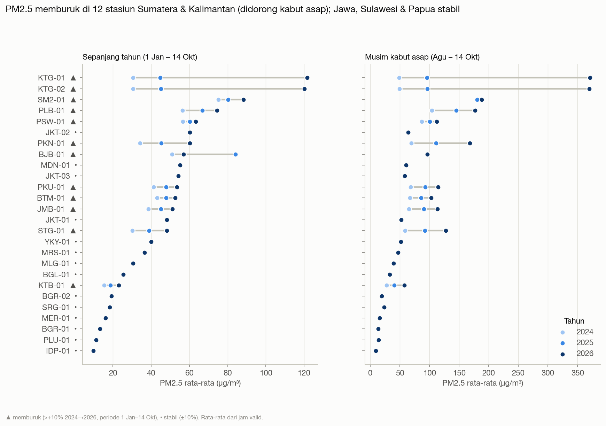

#### 3.1.2 Waktu & Wilayah Paling Kritis
- **Jam:** dua puncak setiap hari, **07–08 dan 18–19 WIB**, di semua tipe lokasi. NO₂ di tepi jalan naik dari 37 menjadi 49 µg/m³ (+33%) pada jam tersebut.
- **Hari kerja vs akhir pekan:** **tidak ada perbedaan bermakna**; selisih <±1% di hampir semua stasiun, hanya 6 dari 75 uji yang signifikan, dan selisih maksimal 5%. Jam sibuk terjadi tujuh hari seminggu.
- **Musim:** di stasiun gambut, PM2.5 kemarau (Mei–Okt) jauh lebih tinggi daripada musim hujan. Di Jakarta dan Bogor selisihnya hanya 0–8%.

  | Stasiun | Kenaikan kemarau vs hujan | Bulan puncak | PM2.5 bulan puncak (µg/m³) |
  |---|---|---|---|
  | KTG-01/02 | +338% | Oktober | 235 |
  | PKN-01 | +240% | — | — |
  | STG-01 | +207% | — | — |
  | PLB-01 | +147% | — | — |

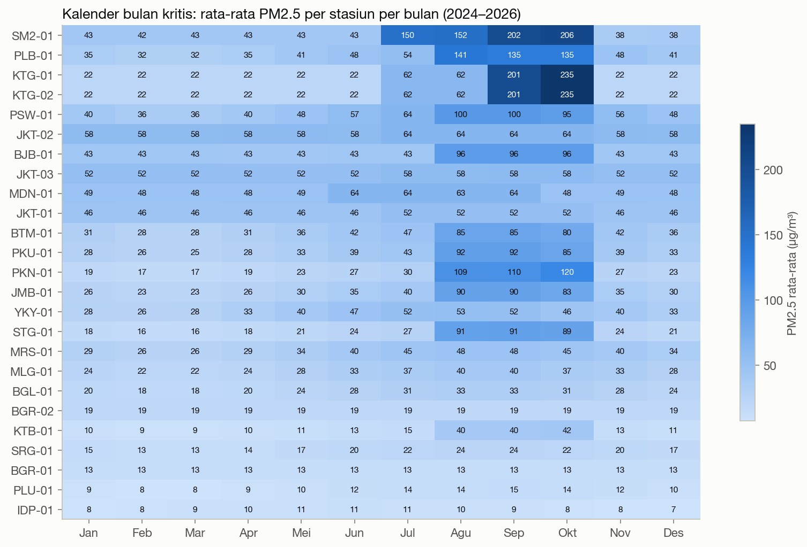
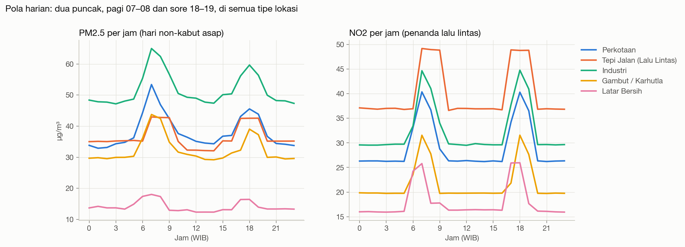

**Karakteristik kawasan perkotaan, industri, dan latar bersih** (tipe lokasi dari `sites.csv`)

**Tabel 3.1 Profil pencemaran menurut tipe lokasi**

| Tipe lokasi | Stasiun | PM2.5 | NO₂ | CO | % hari > baku mutu 24 jam PM2.5 | Kenaikan PM2.5 kemarau vs hujan | Hari kabut asap per stasiun |
|---|---|---|---|---|---|---|---|
| Industri | 4 | **55,8** | 31,6 | 794 | **34,8%** | +66% | 76 |
| Gambut / karhutla | 7 | 51,3 | 22,1 | 487 | 25,5% | **+177%** | **221** |
| Perkotaan | 7 | 45,6 | 29,0 | 700 | 16,1% | +86% | 67 |
| Tepi jalan | 2 | 36,6 | **40,0** | **1.201** | 17,3% | +4% | 0 |
| Latar bersih | 6 | 14,5 | 17,4 | 355 | 0,1% | +54% | 1 |

*Konsentrasi dalam µg/m³.*

- **Industri:** paling tercemar PM2.5 dan paling sering melewati baku mutu harian, karena polusinya tinggi sepanjang tahun.
- **Tepi jalan:** penanda lalu lintas tertinggi (NO₂ dan CO), tetapi hampir tidak dipengaruhi musim.
- **Gambut:** paling musiman, dengan kenaikan hampir 3 kali lipat saat kemarau.
- **Latar bersih:** tetap rendah sepanjang tahun.
- **Catatan "Perkotaan":** kelompok ini mencakup KTG-01 dan PSW-01, yang juga terdampak kabut asap.

**Episode kabut asap**
- **Jumlah dan puncak per tahun:**

  | Tahun | Episode | Hari-stasiun | Puncak harian |
  |---|---|---|---|
  | 2024 | 38 | 714 | 245 µg/m³ |
  | 2025 | 30 | 841 | 207 µg/m³ |
  | 2026 (s.d. 14 Okt) | 16 | 767 | **1.128 µg/m³** (KTG-01, ISPU Berbahaya) |

- **Durasi:** episode makin panjang. Di Kalimantan Tengah, episode 2026 berlangsung terus 106 hari (1 Juli–14 Oktober).
- **Perbedaan sumber asap:**
  - Di KTG-01/02, CO naik +150% saat episode, dan di PLB-01, KTB-01, SM2-01 naik +26–41%. Pola ini konsisten dengan kebakaran di dekat stasiun.
  - Di BTM-01, PKU-01, JMB-01, PSW-01, BJB-01, PM2.5 naik 2–3 kali tanpa kenaikan CO. Pola ini konsisten dengan asap yang terbawa dari wilayah lain.
  - Ini interpretasi, karena dataset tidak memuat data lokasi api.

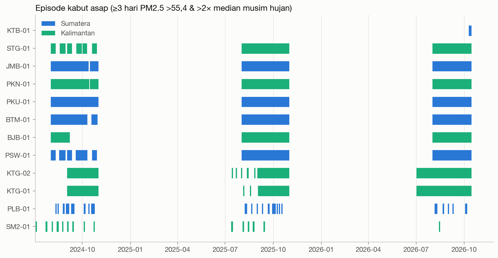

**Wilayah paling kritis** (skor gabungan dari tingkat PM2.5, % hari melewati baku mutu, P98, dan hari ISPU Tidak Sehat+):

| Peringkat | Stasiun | Wilayah | Jenis masalah |
|---|---|---|---|
| 1 | PSW-01 | Pesawaran | 48% hari Tidak Sehat |
| 2 | KTG-02 | Sampit | Kabut asap |
| 3 | JKT-02 | Marunda | Kronis industri; 100% hari > baku mutu 24 jam |
| 4 | KTG-01 | Palangka Raya | Kabut asap |
| 5 | JKT-03 | Cengkareng | Kronis tepi jalan |
| 6 | PLB-01 | Palembang | Kabut asap |

#### 3.1.3 Faktor yang Memengaruhi Variasi Polutan

| Faktor | Bukti dari data | Kekuatan |
|---|---|---|
| Musim (bulan) | 42% kepentingan; Random Forest PM2.5 harian, R² uji 2026 = 0,87 | Terkuat |
| Tipe lokasi | 21% kepentingan. Rata-rata PM2.5 musim hujan menurut tipe lokasi: • Latar bersih: 11 • Gambut: 28 • Perkotaan: 34 • Tepi jalan: 36 • Industri: 40 µg/m³ | Kuat |
| Intensitas lalu lintas | Spearman ρ = 0,75 (p < 0,001) dengan PM2.5 musim hujan antarstasiun. Regresi log-log: elastisitas 0,48, R² = 0,73 (+10% kendaraan ≈ +4,8% PM2.5) | Kuat |
| Jarak ke jalan raya | ρ = −0,65, tetapi tidak signifikan (p = 0,84) setelah lalu lintas dikontrol | Tumpang-tindih dengan lalu lintas |
| Suhu & kelembapan | Korelasi per jam \|r\| < 0,2 di sebagian besar stasiun. Kuat di MDN-01, BJB-01, MER-01 (\|r\| 0,55–0,67) | Lokal |
| Kecepatan angin | Tidak signifikan pada model efek tetap stasiun | Lemah |
| Arah angin | Berpengaruh >10% hanya di IDP-01 (dari utara, +35%), MER-01 (dari selatan, +33%), PLB-01 (dari selatan, +27%) | Lokal |
| Hari dalam minggu | 0% kepentingan | Tidak berpengaruh |

**Faktor untuk polutan lain.** Polutan selain PM2.5 dipengaruhi faktor yang berbeda:
- **O₃ (ozon):** satu-satunya polutan yang jelas dipengaruhi cuaca. O₃ naik saat suhu tinggi (r = +0,41) dan turun saat lembap (r = −0,41) di **26 dari 26 stasiun**, konsisten dengan pembentukan ozon secara fotokimia. O₃ tidak berkaitan dengan lalu lintas (ρ = 0,00).
- **PM10:** paling kuat berkaitan dengan lalu lintas (ρ = 0,80), dan tipe lokasi berbeda nyata untuk PM10 maupun PM2.5 (Kruskal–Wallis p = 0,007 dan 0,010).
- **SO₂:** berkorelasi dengan kecepatan angin di 12 stasiun, dan menurun dengan jarak ke jalan (ρ = −0,42; p = 0,04).
- **NO₂ dan CO:** hubungan antarstasiunnya dengan lalu lintas lemah sampai sedang (ρ ≈ 0,35; p 0,08–0,10). Nilai tertingginya berada di tiga stasiun Jakarta (lihat Gambar 3.8).

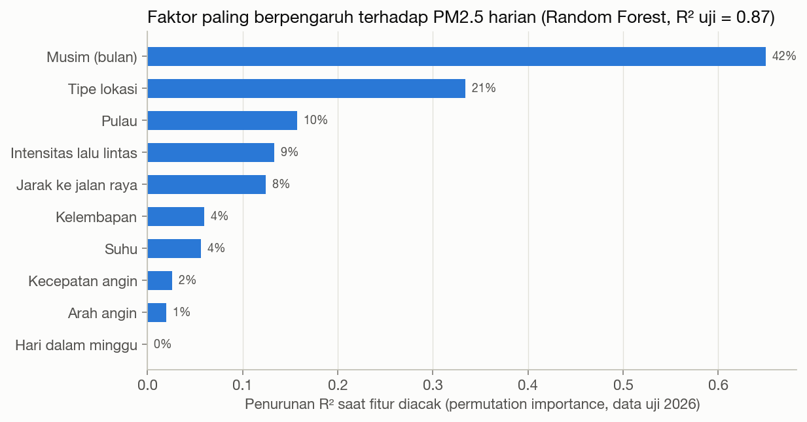
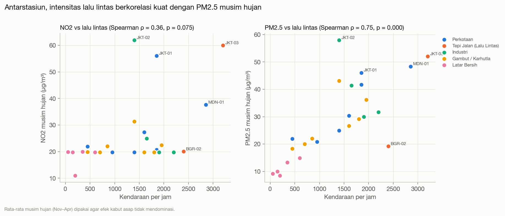

#### 3.1.4 Dampak Kesehatan pada Kelompok Rentan

**Metode**
- **Model:** regresi quasi-Poisson harian per RS (Bhaskaran dkk., 2013) dengan kontrol tren waktu (spline 12 df), suhu (spline), kelembapan, hari, dan efek tetap RS.
- **Rentang paparan:** efek per +10 µg/m³ dihitung pada hari dengan PM2.5 ≤150,4 µg/m³ (≈99% data), karena kurvanya melandai pada kabut ekstrem. Rentang penuh dianalisis per kategori ISPU.
- **Efek jeda:** diestimasi dengan *distributed lag model* (Schwartz, 2000), yang memasukkan lag 0–7 sekaligus.
- **Cakupan:** 25 RS untuk model per jeda, dan 24 RS untuk *distributed lag model*, yang membutuhkan 8 hari berturut-turut lengkap.
  - RS-XXX-27 tidak punya data paparan karena stasiun pasangannya rusak.
  - RS-XXX-23 (MER-01) terlalu sedikit hari yang lengkap.
  - RS-XXX-24 (MDN-01) tidak memiliki 8 hari berturut-turut yang lengkap.

**Tabel 3.2 Kenaikan kasus per +10 µg/m³ PM2.5**

| Kasus | Lag 0 | Kumulatif 0–7 hari | Hari kabut asap vs hari normal |
|---|---|---|---|
| ISPA balita (<5 th) | **+13,6%** | +13,8% | **+156%** |
| ISPA lansia (>60 th) | +13,8% | +13,4% | +146% |
| PPOK | +13,4% | +13,8% | +155% |
| Darurat asma | +12,6% | +13,3% | +125% |
| Pernapasan umum (semua umur) | +11,2% | +11,0% | +115% |
| Kematian | +6,6% | +6,6% | +74% |
| Kardiovaskular | +4,9% | +5,0% | +50% |

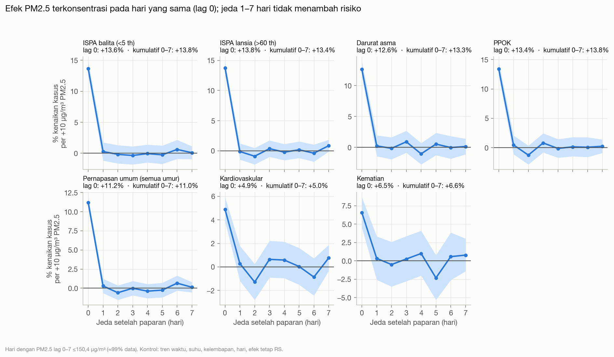

**Temuan**
- **Efek jeda:** dampak terjadi **pada hari yang sama (lag 0)**. Tidak satu pun dari 49 koefisien lag 1–7 yang signifikan.
- **Kurva dosis-respons:** risiko naik bertahap mengikuti kategori ISPU. Risiko relatif (RR) dibandingkan hari *Baik*:

  | Kategori ISPU | RR ISPA balita |
  |---|---|
  | Sedang | ×1,15 |
  | Tidak Sehat | ×2,08 |
  | Sangat Tidak Sehat | ×3,38 |
  | Berbahaya | ×3,93 |

  Kardiovaskular dan kematian berbeda polanya: hampir datar sampai *Sangat Tidak Sehat*, lalu melonjak **×7,4 pada kategori Berbahaya**.
- **Kerentanan balita vs lansia:**
  - **Risiko relatif:** balita sedikit lebih sensitif (+13,7% vs +13,2% per 10 µg/m³ pada rata-rata 3 hari; z = 2,9). Pola yang sama muncul di Sumatera, Jawa, dan Kalimantan, serta pada kategori Sangat Tidak Sehat (RR 3,38 vs 2,98).
  - **Jumlah absolut:** lansia menyumbang kasus lebih banyak (7,2 vs 6,0 kasus per RS per hari normal di RS terdampak kabut).
- **Beban teratribusi** (kasus yang tidak akan terjadi bila PM2.5 di kategori *Baik*):

  | Kasus | Jumlah teratribusi | Persentase |
  |---|---|---|
  | ISPA balita | ±42.700 | 26,0% |
  | ISPA lansia | ±44.200 | 22,1% |
  | Pernapasan umum | ±123.700 | 18,8% |
  | Kematian | ±4.300 | 9,4% |

  Beban relatif tertinggi ada di Kalimantan (32,2% ISPA balita; 17,0% kematian).

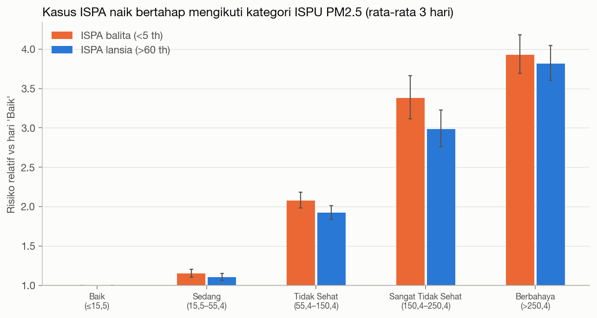

#### 3.1.5 Kecukupan Jaringan Pemantauan
Analisis ini hanya memakai koordinat, status, dan kelengkapan data dalam dataset. Celah cakupan diukur dengan *minimum spanning tree* antarstasiun di setiap pulau: sisi terpanjangnya adalah bentang terluas tanpa titik pantau.

**Tabel 3.3 Cakupan jaringan per pulau**

| Pulau | Stasiun | Andal | Median jarak ke stasiun terdekat | Celah terlebar |
|---|---|---|---|---|
| Sumatera | 10 | 6 | 195 km | PKU-01–MDN-01, 453 km (juga IDP-01–MDN-01, 425 km) |
| Jawa | 7 | 7 | 18 km (5 stasiun mengelompok di Jakarta–Bogor) | BGR-01–YKY-01, 394 km |
| Kalimantan | 6 | 5 | 159 km | KTG-01–SM2-01, 409 km |
| Sulawesi | 2 | 2 | 370 km | MRS-01–PLU-01, 378 km |
| Papua | 2 | 1 | **1.279 km** | SRG-01–MER-01, **1.319 km** |

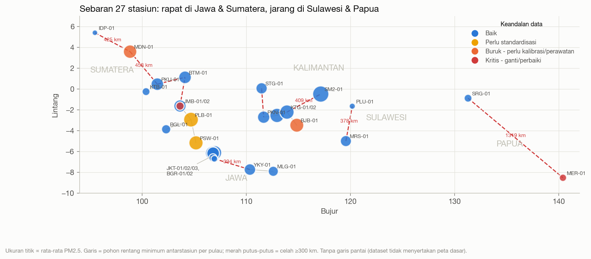

**Masalah keandalan alat**

| Stasiun | Masalah |
|---|---|
| JMB-02 | Rusak (*defective*), 0,5% data valid; tipe "Peatland & Plantation Hinterland" dengan baseline PM2.5 tertinggi di `sites.csv` (68,9) |
| MER-01 | 20% data valid |
| BJB-01 | Sensor macet 7.329 jam tanpa terdeteksi QC otomatis |
| MDN-01 | 3.632 jam tidak terekam |
| PLB-01 | Resolusi rekaman berubah-ubah |
| BJB-01, MDN-01, PSW-01 | Ekspor dalam ppm |

**Skor prioritas** (0–100, min-max) dihitung dari lima komponen berbobot:

| Komponen | Bobot |
|---|---|
| Polusi | 25% |
| Kabut asap | 20% |
| Beban kesehatan per 100 tempat tidur | 20% |
| Defisit data | 20% |
| Keterisolasian | 15% |

Komponen yang datanya tidak tersedia tidak diimputasi; skor dihitung dari komponen yang ada. Peringkat teratas:

| Peringkat | Stasiun | Skor |
|---|---|---|
| 1 | KTG-02 | 68 |
| 2 | PSW-01 | 63 |
| 3 | KTG-01 | 61 |
| 4 | PLB-01 | 57 |
| 5 | BTM-01 | 56 |
| 6 | PKU-01 | 55 |
| 7 | PKN-01 | 54 |
| 8 | BJB-01 | 51 |
| 9 | STG-01 | 50 |
| 10 | MER-01 | 49 |

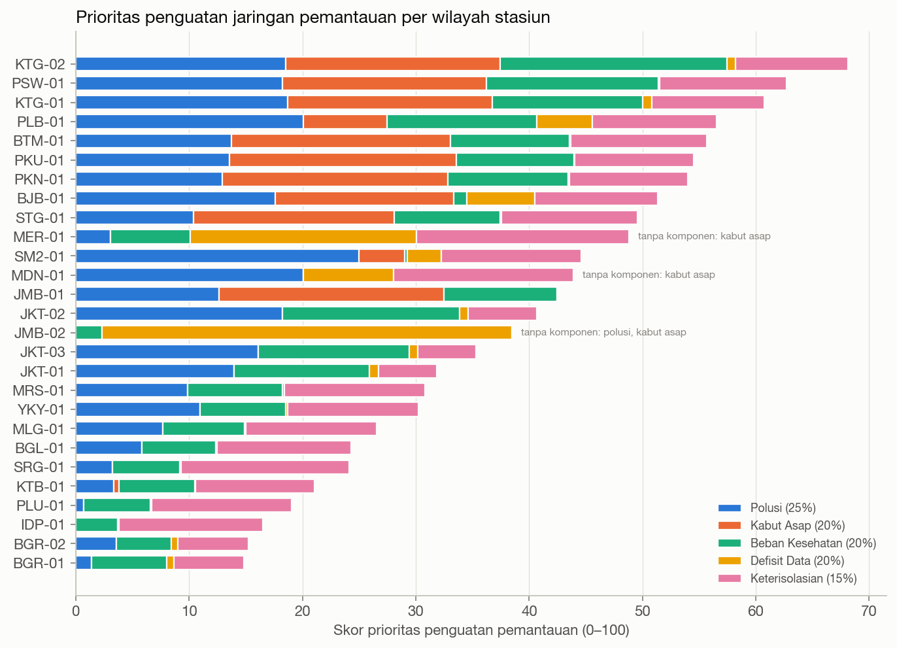

### 3.2 Tampilan Dashboard
[Tangkapan layar penuh dashboard + gambaran fitur utama — diisi]

### 3.3 Pembahasan Setiap Visualisasi Dashboard
[Untuk tiap visual: grafik, analisis, interpretasi — diisi. Isi analisis dapat diambil dari subbab 3.1.]

---

## BAB IV PENUTUP

### 4.1 Kesimpulan
1. **Kondisi kualitas udara.**
   - **PM2.5:** sebagian besar wilayah tidak memenuhi baku mutu. Pada setiap tahun 2024–2026 hanya 3 stasiun yang memenuhi baku mutu tahunan, dan tidak ada yang memenuhi pedoman WHO.
   - **Antarpulau:** Kalimantan paling tercemar, Papua paling bersih.
   - **Jakarta:** NO₂ dan O₃ tahunan melewati baku mutu, dan IKU-nya berkategori *Kurang* hingga *Sangat Kurang*.
   - **Baku mutu 1 jam:** tidak pernah terlampaui untuk gas apa pun.
2. **Dua jenis masalah.**
   - **Kronis perkotaan/industri di Jakarta:** sepanjang tahun, tanpa musim.
   - **Episodik karhutla di Sumatera dan Kalimantan:** setiap Agustus–Oktober, dengan intensitas yang membesar dari tahun ke tahun. Puncaknya berkategori Berbahaya di Kalimantan Tengah pada 2026.
3. **Faktor penentu.**
   - **PM2.5 & PM10:** musim dan tipe lokasi paling menentukan variasinya. Di luar musim kabut, intensitas lalu lintas menjelaskan sebagian besar perbedaan antarstasiun.
   - **Cuaca:** hanya kuat memengaruhi O₃, yang naik saat suhu tinggi di semua stasiun.
4. **Dampak kesehatan.**
   - **Waktu efek:** muncul pada hari yang sama. Setiap +10 µg/m³ menaikkan kasus ISPA balita dan lansia sekitar 13–14%, dan kematian sekitar 6–7%.
   - **Kelompok rentan:** balita sedikit lebih sensitif, sedangkan lansia menyumbang kasus lebih banyak.
   - **Polusi ekstrem:** pada kategori Berbahaya, risiko kematian dan kardiovaskular melonjak sekitar 7 kali.
5. **Jaringan pemantauan.** Jaringan belum memadai: 6 dari 27 stasiun tidak andal, dan terdapat celah 378–1.319 km di Sumatera bagian utara, Jawa bagian tengah, Kalimantan, Sulawesi, dan Papua.

### 4.2 Rekomendasi
1. **Peringatan dini di hari yang sama.** Karena efek kesehatan terjadi di hari yang sama, peringatan ISPU harus disampaikan **hari itu juga**. Prioritaskan perlindungan balita, dan siapkan kapasitas rawat inap untuk lansia ketika ISPU mencapai *Tidak Sehat*.
2. **Kesiapsiagaan kabut asap Juli–Oktober.**
   - **Lokasi:** 9 stasiun dengan ≥200 hari-stasiun kabut asap: Riau (PKU-01), Kalimantan Tengah (PKN-01, KTG-01/02), Jambi (JMB-01), Kepulauan Riau (BTM-01), Lampung (PSW-01), Kalimantan Barat (STG-01), dan Kalimantan Selatan (BJB-01).
   - **Kapasitas rumah sakit:** saat episode, kasus ISPA balita naik sekitar 2,5 kali, sehingga kapasitas RS perlu ditambah.
3. **Pengendalian pada jam sibuk 07–08 & 18–19 WIB, tujuh hari seminggu**, terutama di Jakarta (JKT-01/02/03). NO₂ dan O₃ tahunan di sana melewati baku mutu, dan Marunda melewati baku mutu PM2.5 24 jam setiap hari.
4. **Perbaikan alat:**
   - ganti JMB-02;
   - pulihkan MER-01;
   - kalibrasi BJB-01 dan MDN-01;
   - seragamkan ekspor logger ke µg/m³ dengan resolusi 1 jam;
   - tambahkan aturan deteksi *flatline* pada QC otomatis.
5. **Penambahan titik pantau** pada celah terlebar:
   - SRG-01–MER-01 (Papua);
   - PKU-01–MDN-01 dan IDP-01–MDN-01 (Sumatera bagian utara);
   - KTG-01–SM2-01 (Kalimantan);
   - BGR-01–YKY-01 (Jawa);
   - MRS-01–PLU-01 (Sulawesi).
6. **Investigasi sumber di Samarinda (SM2-01)**, yang tingkat dasarnya naik 23% per tahun.

---

## DAFTAR PUSTAKA
Bhaskaran, K., Gasparrini, A., Hajat, S., Smeeth, L., & Armstrong, B. (2013). Time series regression studies in environmental epidemiology. *International Journal of Epidemiology, 42*(4), 1187–1195. https://doi.org/10.1093/ije/dyt092

Breiman, L. (2001). Random forests. *Machine Learning, 45*(1), 5–32. https://doi.org/10.1023/A:1010933404324

Kementerian Lingkungan Hidup dan Kehutanan. (2020). *Peraturan Menteri Lingkungan Hidup dan Kehutanan Nomor P.14/MENLHK/SETJEN/KUM.1/7/2020 tentang Indeks Standar Pencemar Udara*.

Kementerian Lingkungan Hidup dan Kehutanan. (2021). *Peraturan Menteri Lingkungan Hidup dan Kehutanan Nomor 27 Tahun 2021 tentang Indeks Kualitas Lingkungan Hidup*.

Mann, H. B. (1945). Nonparametric tests against trend. *Econometrica, 13*(3), 245–259. https://doi.org/10.2307/1907187

Panitia Gelar Rasa 2026. (2026). *Booklet case study DA Gelar Rasa 2026*; *Handbook preliminary round DA Gelar Rasa 2026*; *Rekap QnA*.

Pemerintah Republik Indonesia. (2021). *Peraturan Pemerintah Nomor 22 Tahun 2021 tentang Penyelenggaraan Perlindungan dan Pengelolaan Lingkungan Hidup*.

Schwartz, J. (2000). The distributed lag between air pollution and daily deaths. *Epidemiology, 11*(3), 320–326. https://doi.org/10.1097/00001648-200005000-00016

Seinfeld, J. H., & Pandis, S. N. (2016). *Atmospheric chemistry and physics: From air pollution to climate change* (3rd ed.). Wiley.

Sen, P. K. (1968). Estimates of the regression coefficient based on Kendall's tau. *Journal of the American Statistical Association, 63*(324), 1379–1389. https://doi.org/10.1080/01621459.1968.10480934

World Health Organization. (2021). *WHO global air quality guidelines: Particulate matter (PM2.5 and PM10), ozone, nitrogen dioxide, sulfur dioxide and carbon monoxide*. World Health Organization. https://www.who.int/publications/i/item/9789240034228

---

## LAMPIRAN

**A. Link dashboard:** [diisi — pastikan dapat dibuka tanpa meminta akses]

**B. Repository kode (opsional):** skrip `analysis/01_clean.py` (preprocessing), `02_air_quality.py`, `03_health_network.py`, `04_export_excel.py`.

**C. Grafik tambahan**

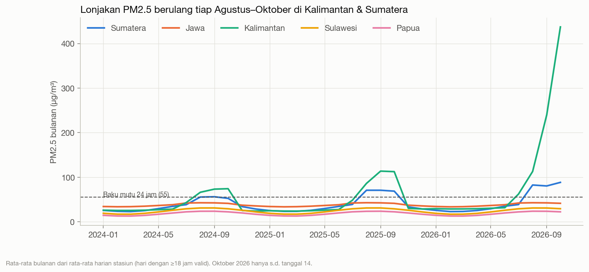
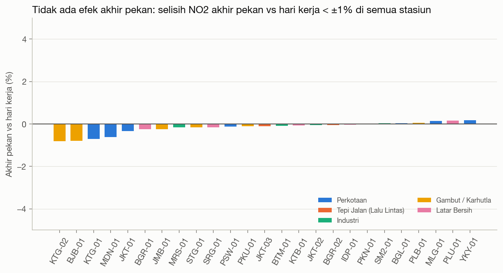
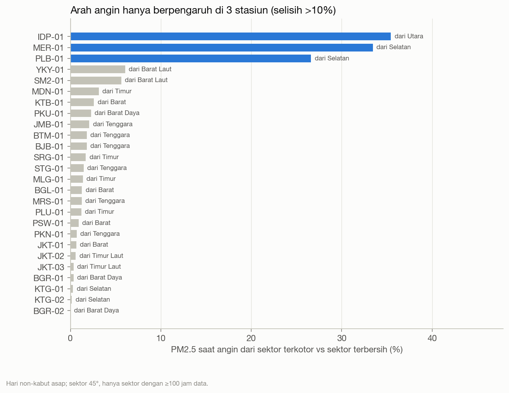

**D. File keluaran**

| File | Isi |
|---|---|
| `output/GelarRasa2026_Data_Bersih.xlsx` | Tabel bersih untuk dashboard: `unit_conversion_ppm`, `dim_station`, `data_quality_station`, `cleaning_log`, `aqms_daily`, `aqms_monthly`, `health_aq_daily` |
| `output/GelarRasa2026_Hasil_Analisis.xlsx` | 43 tabel hasil analisis |
| `output/clean/aqms_hourly_clean.csv` / `.parquet` | Data per jam bersih (655.808 jam terekam) |
| `output/figures/*.png` | 15 grafik |
